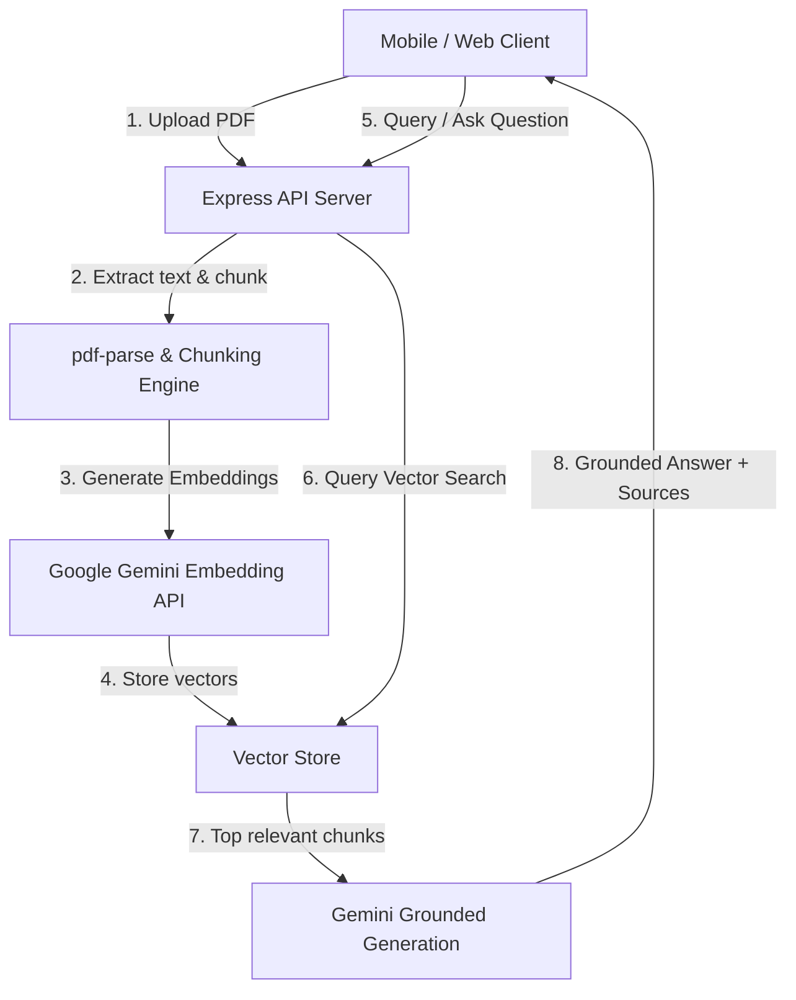

# DocuSense AI 📄⚡

> Grounded Document Intelligence & Retrieval-Augmented Generation (RAG) powered by Google Gemini and React Native / Expo.

DocuSense AI is a full-stack AI-driven document intelligence system. Upload PDF documents, automatically index and extract semantic text chunks, and query document contents using grounded question-answering with verifiable citations.

---

## 🚀 Features

- **📄 PDF Text Extraction & Semantic Chunking**: Automatically extracts and splits document text into context-rich paragraph chunks (300–500 words).
- **🧠 Vector Embeddings & Similarity Search**: Uses Google Gemini's embedding models (`gemini-embedding-001`) with in-memory cosine similarity search to retrieve the top relevant context passages.
- **🛡️ Grounded AI Responses**: Answers queries strictly based on document evidence with explicit chunk citations (`[Chunk 1]`), avoiding hallucinations.
- **📱 Cross-Platform Mobile / Web Interface**: Built with React Native & Expo supporting iOS, Android, and Web browsers.
- **🎨 Modern Dark / Light Mode**: Sleek violet & dark slate theme with live indexing badges and quick preset queries.

---

## 🏗️ Architecture



---

## 🛠️ Tech Stack

- **Backend**: Node.js, Express 5, Multer, `pdf-parse`
- **AI & LLM**: `@google/genai` (Gemini Embedding & Gemini 2.5 Flash Lite)
- **Frontend**: React Native 0.86, React 19, Expo 57, React Native Web

---

## 🏁 Getting Started

### 1. Clone the Repository
```bash
git clone https://github.com/Prateek-2812/docusense-ai.git
cd docusense-ai
```

### 2. Configure Environment Variables
Create a `.env` file in the root directory:
```bash
cp .env.example .env
```
Add your Google Gemini API key:
```env
PORT=3000
GEMINI_API_KEY=your_gemini_api_key_here
```

### 3. Install Dependencies
```bash
# Install backend dependencies
npm install

# Install mobile/web dependencies
cd mobile
npm install
cd ..
```

### 4. Run the Backend Server
```bash
npm start
```
The server will start on `http://localhost:3000`.

### 5. Run the Mobile / Web Client
In a separate terminal:
```bash
cd mobile
npx expo start
```
- Press **`w`** to open in web browser (`http://localhost:8081`).
- Scan the QR code with **Expo Go** on iOS or Android.

---

## 📡 API Endpoints

| Method | Endpoint | Description |
|---|---|---|
| `POST` | `/api/upload` | Upload and index a PDF document (`multipart/form-data`) |
| `POST` | `/api/ask` | Query the indexed document (`{ "question": "..." }`) |
| `GET` | `/api/status` | Check indexed chunk count and readiness status |

---

## 📄 License
ISC
